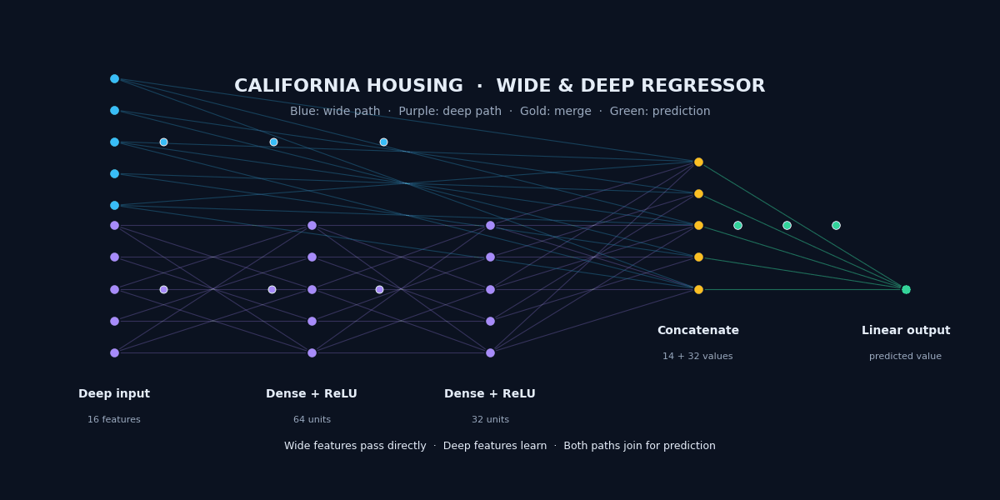

# California Housing Price Prediction

A learning project that explores California census housing data and builds a **wide-and-deep neural network** to estimate median house value by census block group.

The notebook compares feature-engineering experiments and examines a key data issue: target values at the top of the dataset are capped at **$500,001**. Because the data is historical, this is an exploration of model-building techniques rather than a tool for estimating current home prices.

## Model at a glance

The wide path carries engineered features directly to the final layer. The deep path learns a nonlinear representation through two dense layers. Their values are concatenated to produce one price estimate.



To regenerate the animation:

```bash
python visualizations/animate_network.py
```

## Current baseline

One saved notebook run reports the following on a fixed 20% validation split:

| Metric | Saved result |
| --- | ---: |
| RMSE | $61,900 |
| MAE | $42,448 |

These are exploratory results, not a final benchmark. Rerun the notebook from a fresh kernel before comparing experiments. The correlation-based feature-selection experiments now rank features using training rows only, then apply the same selected columns to validation rows. The validation set is reused across experiments, so it should not be treated as an independent final score. Dropping capped-price rows also changes the population being predicted.

## Project contents

```text
.
├── data/housing.csv                 # bundled housing dataset
├── models/model.py                  # PyTorch wide-and-deep model
├── models/train.py                  # training and evaluation loops
├── visualizations/animate_network.py
├── assets/wide_and_deep_network.gif
├── california_map.png               # geographic reference image
└── sample.ipynb                     # EDA, features, experiments, evaluation
```

The CSV contains the familiar California housing census fields, including location, household statistics, median income, ocean proximity, and median house value. The dataset is derived from 1990 U.S. Census data; see the [California housing dataset documentation](https://keras.io/api/datasets/california_housing/) for background.

## Run it locally

Use Python 3.10 or newer.

```bash
python -m venv .venv
source .venv/bin/activate        # Windows: .venv\Scripts\activate
python -m pip install -r requirements.txt
jupyter lab sample.ipynb
```

In Jupyter, restart the kernel and run the notebook from the top. The notebook selects MPS on Apple Silicon, CUDA when available, or CPU otherwise.

## What the notebook does

1. Inspects missing values, feature distributions, geography, and the target-value cap.
2. Adds household ratios, log-count features, and location/ocean-proximity interactions.
3. Splits the data, fits scaling and feature selection on training data only, and trains the wide-and-deep model.
4. Reviews validation errors and explores the effects of removing capped targets and low-correlation features.

## Next improvements

- Move preprocessing and feature selection into a reusable pipeline fitted on training folds only.
- Compare the neural network with a mean baseline, linear regression, and a tree-based model.
- Tune the learning rate and loss on a validation set, then report one final result on a held-out test set.
- Treat the capped target explicitly; do not interpret the capped values as exact prices above $500,001.
- Add a small prediction script and a data/model card describing intended use and limitations.

## Tools

Python · pandas · scikit-learn · PyTorch · Matplotlib · Seaborn · Jupyter
